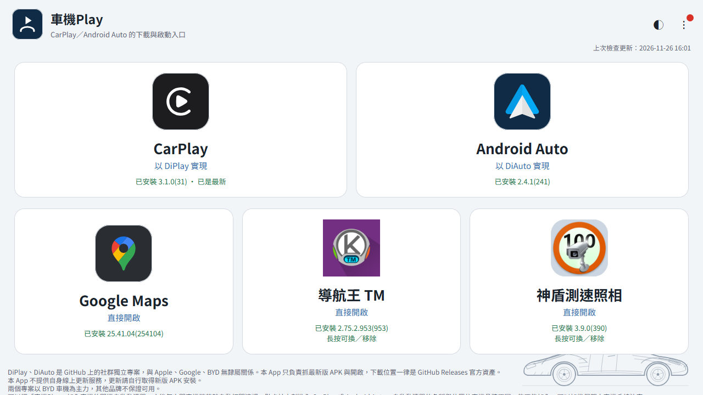
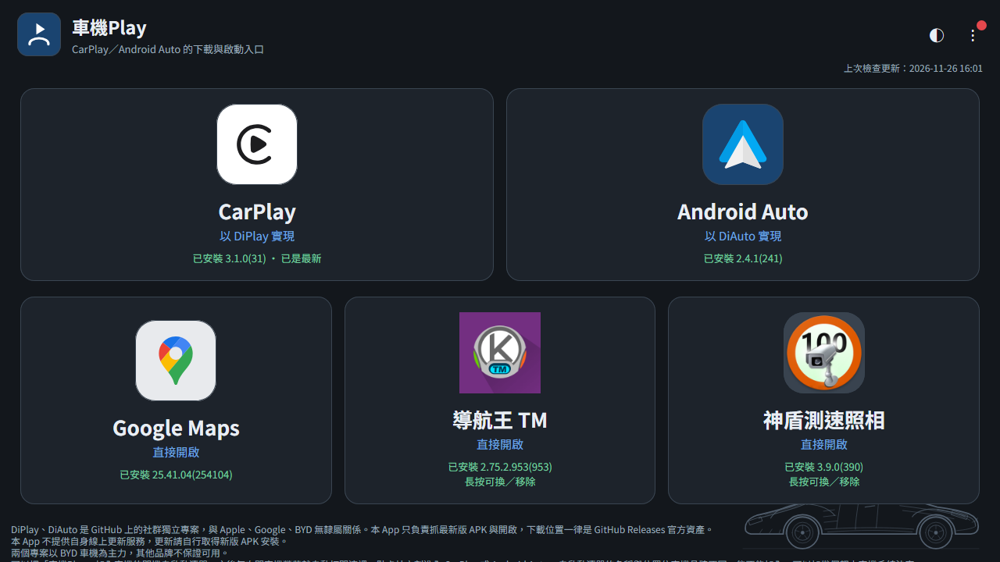
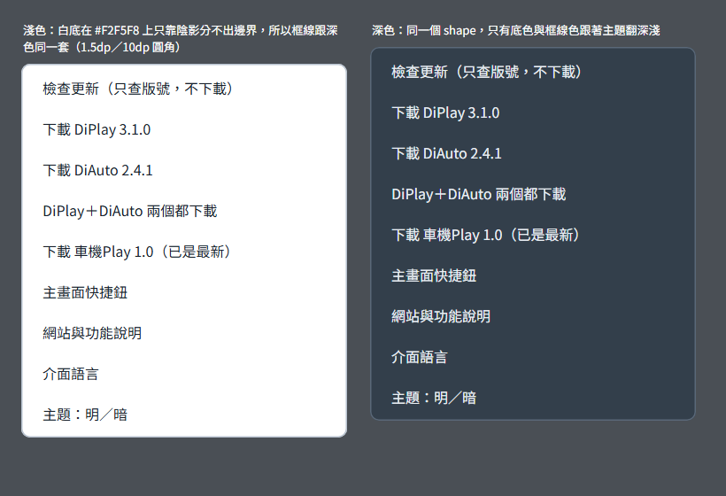
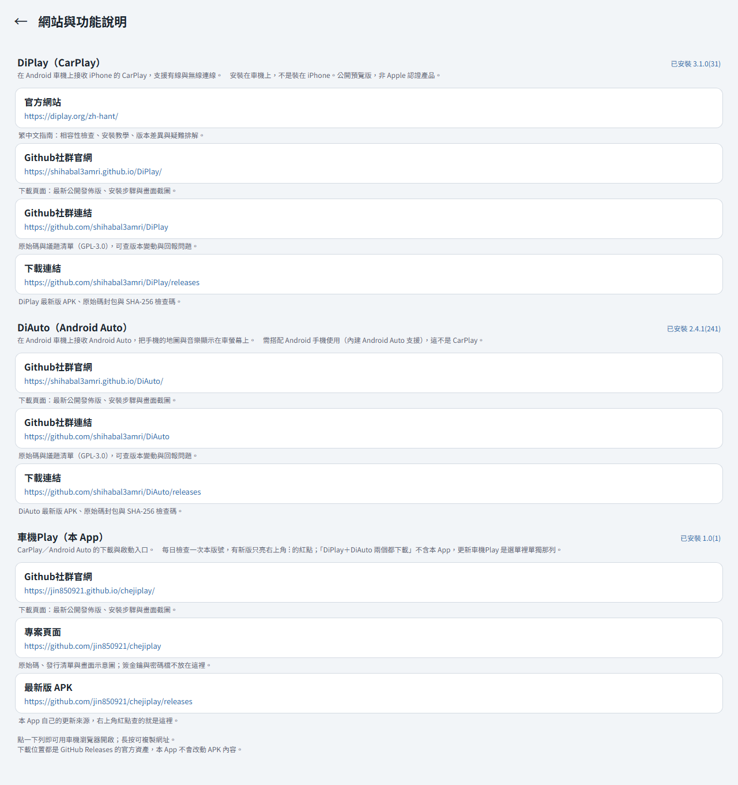
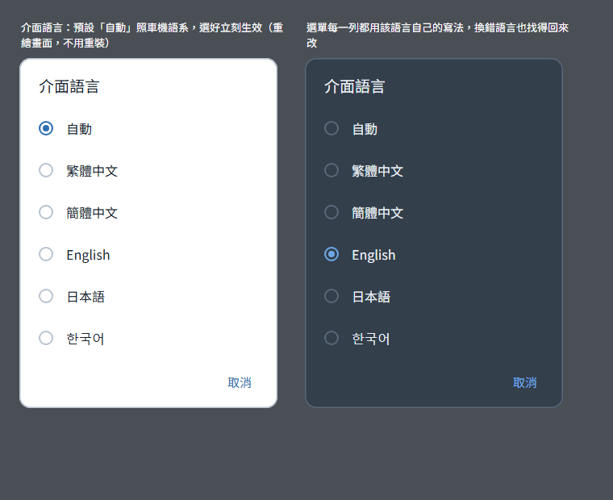
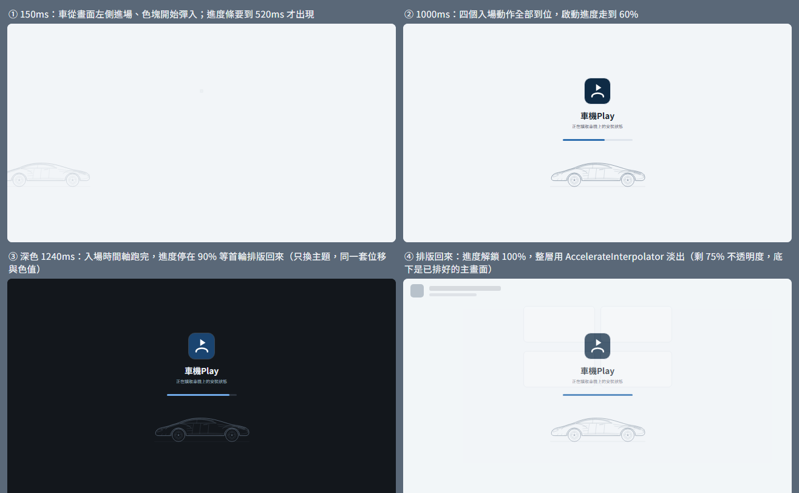
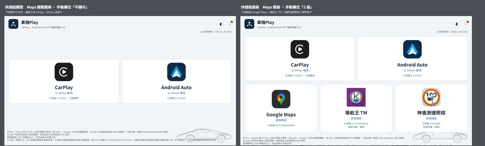
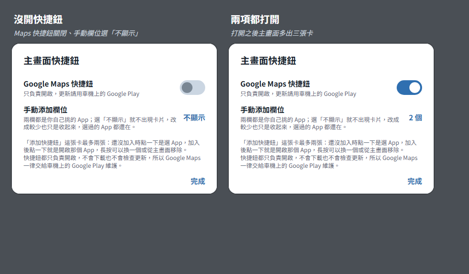
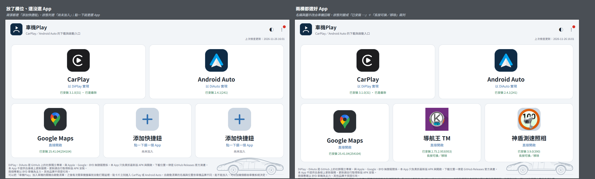

# 車機Play（com.cheji.play）

[繁體中文（台灣）](README.md) · [简体中文](README.zh-CN.md) · [English](README.en.md) · [日本語](README.ja.md) · [한국어](README.ko.md)

**社群官網：<https://jin850921.github.io/chejiplay>**——同一份介紹的網頁版，五種語言各一頁。

Android 車機用的 CarPlay／Android Auto 下載與啟動入口。一個離線可重建的純 Java／framework 專案：
沒有 Gradle、沒有 AndroidX、沒有任何第三方相依。

## 畫面

每張圖都是 1:1 原尺寸（主畫面 1280×720），點圖就開原檔。

| 主畫面（淺色） | 主畫面（深色） |
| --- | --- |
| [](docs/screenshots/01_主畫面_淺色.png) | [](docs/screenshots/02_主畫面_深色.png) |

| 右上角 ⋮ 選單 | 網站與功能說明 | 介面語言 |
| --- | --- | --- |
| [](docs/screenshots/03_右上角選單.png) | [](docs/screenshots/04_網站與功能說明.png) | [](docs/screenshots/05_介面語言.png) |

| 載入動畫的四個時間點 |
| --- |
| [](docs/screenshots/06_載入動畫.png) |

| 主畫面快捷鈕：關閉 → 開啟 | 設定頁「主畫面快捷鈕」：關閉 → 開啟 |
| --- | --- |
| [](docs/screenshots/07_主畫面快捷鈕前後對比.png) | [](docs/screenshots/08_快捷鈕設定前後對比.png) |

| 開了手動欄位、還沒選 App → 兩欄都選好 App |
| --- |
| [](docs/screenshots/09_手動欄位_未放與已放對比.png) |

示意圖是依 `res/` 裡的實際色值與版面用 Chrome 渲出來的對照圖，不是設計稿；
但**沒有裝上車機驗證過**（見最後一段）。
下排兩張手動欄位示範的是「導航王 TM」（`com.kingwaytek.naviking.telemetrics`）與「神盾測速照相」
（`tw.com.ainvest.outpack`），圖示取自兩支 App 在 Google Play 上的正式 icon，只存在於這些示意圖裡；
實機上卡片名稱與圖示都直接取自車機回報的 `applicationLabel`／`getApplicationIcon`（見「快捷鈕的圖示」那節），
本 App 不擷取、不重打包任何公司的圖檔，也不翻譯 App 名稱。

## 這支 App 做什麼

- 主畫面兩排卡片：上排是 DiPlay（CarPlay）與 DiAuto（Android Auto），下排是 Google Maps 快捷鈕與你自己挑的 1–2 個 App。
- 每天檢查一次 GitHub Releases 的最新版，**不跳任何提醒畫面**；有新版只在右上角 ⋮ 亮起紅點，實際下載與更新一律從 ⋮ 選單裡那幾列執行。
- 卡片本身「就是動作」：沒裝就下載，已裝就開啟；長按才出現取消下載／換 App／移除。
- 下載好的 APK 交給車機自己的安裝程式（透過 `ApkProvider`，不用 FileProvider 的 androidx 版本）。
- 冷開機進主畫面時先蓋一層載入動畫，首輪排版一跑完就整層淡出（見下一節）。

## 載入動畫

`res/layout/activity_main.xml` 最後一個節點 `@+id/splash` 是一層 opaque 的 `LinearLayout`，
蓋在 `ScrollView` 與車身線稿之上；`android:visibility="gone"` 是預設值，由 `MainActivity.playSplash()`
決定要不要打開，所以**只有程式冷開機那一次**會播——換主題、換語言都走 `recreate()`，不會重播。

總長度是一個常數：`SPLASH_TOTAL_MS = 1500`（含最後那層淡出），淡出佔 `SPLASH_FADE_MS = 260`，
所以入場時間軸的基準 `t = 1240`。下面每一個起點與長度在程式裡都是 `t` 的百分比
（`t * 8 / 10` 這種形式），改一個數字整條時間軸就等比加長或縮短。

| 元素 | 起點 | 長度 | 結束 | 緩動 |
| --- | --- | --- | --- | --- |
| 側面車線稿（從畫面左外側開進定位） | 0 | 992 | 992 | `DecelerateInterpolator(1.35)` |
| logo 色塊（彈入＋放大回彈） | 136 | 421 | 557 | `OvershootInterpolator(1.2)` |
| 「車機Play」標題 | 297 | 359 | 656 | `DecelerateInterpolator(1.35)` |
| 「正在讀取車機上的安裝狀態」 | 434 | 359 | 793 | 同上 |
| 進度條淡入 | 520 | 285 | 805 | 線性 |
| **啟動進度 0 → 90%** | 520 | 720 | 1240 | 線性 |
| 整層淡出 | 1240（首輪 `onGlobalLayout` 之後） | 260 | **1500** | `AccelerateInterpolator` |

那條是**確定式**的啟動進度條：它跟進度條淡入同時從 0 走到 90%，
剩下那 10% 由「首輪排版真的回來」這件事解鎖（`scheduleSplashOut` 觸發 `splashOut` 時才補到 100%）。
也就是**初始化還沒排完版，畫面就不會顯示 100%**——慢車機上會看到進度停在九成的那一段。
刻度跟卡片上的下載條一樣是 `max=1000`，兩邊共用同一個上色定義 `Core.Ui.bar()`（accent 當進度、`cpTrack` 當底條），
所以載入條與下載條都不會吃到車機系統的預設色。

兩個邊界是刻意留的：入場時間軸讓動畫一定看得完（初始化再快也不至於閃一下），
`SPLASH_MAX_MS = 3000` 是保險——排版事件沒如預期進來也一定收掉，不會卡在載入層裡；
走這條保險時進度**留在實際到達的數值**，不會假裝讀完。
淡出期間那層 `clickable="true"`，所以動畫還沒結束時點到的是載入層，不會誤觸後面的卡片。

動畫全部用 framework 的 `ViewPropertyAnimator`、`ObjectAnimator` 與 `android.view.animation` 插值器，
沒有 AndroidX、沒有逐格圖、也沒有 `res/anim`；進度條是 `?android:attr/progressBarStyleHorizontal`
搭配 `setProgressTintList()`／`setProgressBackgroundTintList()`。上面那張四格圖是依同一組時間與同一組色值
（`values.xml` 的主題色＋`Core.BRAND_NAVY_LIGHT`／`_DARK`）渲出來的對照圖。

## 快捷鈕的圖示

`MainActivity.applyShortcutIcon()` 是下排那一列圖片唯一的出口：組裝卡片時進一次，
之後每次 `refresh()`（`bindShortcut`）再進一次，所以不會出現「裝完了圖還是舊的」那種要重開才會對的狀態。

- 車機查得到那套 App 自己的圖示 → 用 `PackageManager.getApplicationIcon()` 抓回來，**滿版**蓋在 104dp 色塊上，
  品牌色不壓色。Google Maps 卡跟自訂欄位走同一條路，沒有各畫一套。
- 查不到 → 回到本 App 內建的預設圖，並把圖塊收回 `item_module.xml` 的預設 62dp：
  Google Maps 卡是我自己畫的路徑圖 `ic_maps.xml`（官方配色，不是擷取任何公司的圖檔），
  還沒放 App 的空位是 tint 過的「＋」。
- 已經放进來的自訂欄位如果圖示突然查不到（App 被移除了），**留著畫面上那張**不清空——
  狀態列同時會變成紅色的「尚未安裝」，看得見發生了什麼，不會變成一格無名空白。

即時性靠兩條現成的路，都不必重開程式：`onResume()` 一律重掃一次（車機的安裝畫面常常只讓本頁暫停、
走不到 `onStop`），前台時另外收 `PACKAGE_ADDED`／`REMOVED`／`FULLY_REMOVED` 廣播，
兩者都進 `rescanSoon() → refresh()`。targetSdk 34 之後查不到別人的 App，
所以 `AndroidManifest.xml` 的 `<queries>` 裡已經列了 `com.google.android.apps.maps`。

上面 01／02 那兩張主畫面示意圖裡，Maps 那一格畫的是**查不到 Google Maps 時的內建圖釘**；
車機真的裝了 Maps，那一格會換成 Maps 自己的圖（跟下排手動欄位同樣的滿版畫法）。

## 右上角選單的排序

查詢 → 兩個社群專案 → 本 App 自己 → 設定類，一共 9 列：

1. `檢查更新（只查版號，不下載）`——這列只會查，不會抓 APK；要抓是下面幾列的事。
2. `下載 DiPlay <版號>`
3. `下載 DiAuto <版號>`
4. `DiPlay＋DiAuto 兩個都下載`——批次列，**不含本 App**。
5. `下載 車機Play <版號>`——本 App 自己的更新，跟上面兩列同一條句式；下載中會變成 `取消下載 車機Play 45%`。
6. `主畫面快捷鈕`
7. `網站與功能說明`
8. `介面語言`
9. `主題：明／暗`

## 介面語言

`自動／繁體中文／簡體中文／English／日本語／한국어`。選「自動」就照車機語系（zh-TW／zh-CN／en／ja／ko），
換完立刻重繪畫面，不用重裝、不會掉設定。

實作方式是 `src/com/cheji/play/L.java` 裡的一张字典：key 是繁中原文，後面四個欄位是四種語言的譯文。
畫面所有顯示點走同一個 `L.t()`，所以：

- 繁中模式是**原字串回傳**，日常用的那門語言不會被我改壞。
- 組合出來的句子（例如「下載中 1.2 MB / 3 MB　4%　長按可取消」）靠前綴／後綴／句中片段遞迴拆解，
  不需要改動拼句的那段程式。
- 字典查不到的字串就維持繁中，不會變空白。
- 加一门語言是加一個欄位，不是複製一份 UI 程式。

App 名稱、品牌名（車機Play／DiPlay／DiAuto）與車機上那套 App 的名字刻意不翻；
快捷鈕卡片顯示的是車機回報的名稱，翻了就找不到那支 App。

譯文是我自己寫的，沒有母語人士校過。要改任何一句，改 `L.java` 那一列就好。

## 版號顯示

已安裝的 APK 一律顯示成 `version_name(version_code)`，例如 `1.0(1)`。實作是 `Core.dispVersion()`，
畫面上 10 個顯示點都走它：兩排卡片的狀態列、快捷鈕卡片的狀態列、右上角選單的「下載 …」／「更新 …」列、
檢查結果對話框、以及網站與功能說明頁那三組的狀態。

比對版號用的還是 `Core.installedVersion()` 回傳的裸 `versionName`，`Core.cmpVersion()` 沒有被顯示格式污染。
`versionCode` 在 API 28 以上走 `getLongVersionCode()`，24～27 退回 `versionCode` 欄位。

**只有 GitHub 那端沒有 code**：Release 只有 tag（`v1.0` 這種形式），清單裡讀不到 versionCode，
所以那些句子裡的**目標版號**維持不加括號——括號只出現在查得到實際安裝版本的地方。

手動快捷鈕卡片的「長按可換／移除」提示**固定另起一列**，不接在版號後面：四段式版號再帶七位數 code
這種長度跟提示排在同一列時會從提示中間折斷（斷成「長按可換／」＋「移除」），所以狀態列設計成兩列——
『已安裝 …』／『長按可換／移除』，不管版號多長都一樣。代價是下排卡片多 19dp，說明文字因此更往下推——它本來就在 `ScrollView` 裡，捲動即可看全。

## 免責

DiPlay、DiAuto 是 GitHub 上的獨立社群專案，本 App 與 Apple、Google、BYD 沒有任何隸屬關係，
也不修改、不重新打包它們的 APK——下載位置永遠是對方 Releases 的官方資產。
兩個專案以 BYD 車機為主力，其他品牌不保證可用。

## 社群官網與多語言介紹

DiPlay／DiAuto 各有一頁 GitHub Pages 社群官網，本專案同一個形式：官網就在 `docs/`，
`https://jin850921.github.io/chejiplay/` 是繁中基準頁，另外四語在 `/zh-Hans/`、`/en/`、`/ja/`、`/ko/`。

- **一份來源渲五語**：`docs/content.json` 是五種語言唯一的文字來源，`scripts/build_site.cjs` 用同一個模板
  渲出五個 `index.html`。腳本會比對每個語言的段落數量與條目數量，不一致就直接中止——跟 `L.java`
  「加一门語言是加一組欄位，不是複製一份頁面」同一條道理。
- **色值取自 App**：`docs/assets/site.css` 的明暗兩套直接抄 `res/values/values.xml` 的主題色與
  `Core.BRAND_NAVY_*`，跟著 `prefers-color-scheme` 換，所以官網看起來跟車機上同一個主題。
- **圖片零複製**：Pages 的根就是 `docs/`，頁面直接沿用同一資料夾裡的 `icon.png` 與 `screenshots/*.png`，
  不會把截圖在 repo 裡存兩份。
- **多語言 README 也是產物**：`README.zh-CN.md`／`README.en.md`／`README.ja.md`／`README.ko.md`
  由同一支腳本從同一份 `content.json` 渲出，`node scripts/build_site.cjs` 一次同時更新官網與這四份。
  繁中的 `README.md`（這份）是維護者文件，建置與發佈細節只寫在這裡，四份譯本各留一句指回這裡。
- **發佈**：沒有 CI。Pages 的來源設一次就好——`Settings → Pages → Source: Deploy from a branch`，
  分支 `main`、資料夾 `/docs`（對應的 API 是 `gh api -X PATCH repos/jin850921/chejiplay/pages`
  帶 `{"build_type":"legacy","source":{"branch":"main","path":"/docs"}}`）。
  之後改完 `docs/content.json` 跑一次 `node scripts/build_site.cjs`，push 到 `main` 官網就跟著更新。
- **App 端同一個位置**：「網站與功能說明」頁裡「車機Play（本 App）」那組的第一列就是這個官網，
  跟 DiPlay／DiAuto 的「Github社群官網」同一列同一句式；車機沒有瀏覽器時照既有行為把網址複製到剪貼簿。
- 官網上的「下載 APK」直接指向 Release 資產 `chejiplay-1.0.apk`，與右上角紅點查的是同一個來源。

## 建置

需要 JDK 17、Android SDK（platforms/android-34、build-tools/34.0.0），以及一支簽名用的 PKCS12。

```
node build.cjs <versionName> <versionCode>
# 例：node build.cjs 1.0 1
```

腳本順序：`aapt2 compile`／`link` → `javac`（`-source 8 -target 8`，bootclasspath 用 android-34）→ `jar` → `d8`
→ `jar --update --no-compress` 把 `classes.dex` 塞回未對齊的 APK → `zipalign` → `apksigner`。
輸出檔名 `車機Play_com.cheji.play_<versionName>_<YYYYMMDDHHMMSS>.apk`，同目錄會留 `.idsig` 與 `.stamp`
（`.stamp` 是時間戳，腳本用它把三個檔案的 mtime 釘成同一個時間）。

`keystore.pass` 與 `chejiplay.p12` **不在 repo 裡**：金鑰離開作者手上，任何人都能簽出同套件名的 APK
蓋掉這條更新路，所以兩個檔只留在建置這臺機器。換裝新版必須用同一支金鑰，否則車機會拒絕升級安裝。

## 發佈到 Releases（自更新的約定）

本 App 的每日檢查讀的是這個 repo 的 Releases，規則寫死在 `src/com/cheji/play/Core.java` 的 `Core.SELF`：

- tag：`v<versionName>`（開頭的 `v` 會被折掉，比對用 `1.0` 這種形式）。
- 資產檔名：**ASCII** 前綴 `chejiplay-` ＋ 版號 ＋ `.apk`，例如 `chejiplay-1.0.apk`。
  Downloads 裡那個帶中文的檔名是給人的，Release 上的資產名稱是給程式讀的，兩者內容是同一個位元組序列。
- 一個 Release 只放一支 APK；`draft` 的會被略過，`pre-release` 會被採納（跟 DiPlay 的習慣一致）。
- 程式取的是清單裡**第一個**符合 `chejiplay-` 的資產（API 由新到舊回傳），比對方式是數字段落比較（`Core.cmpVersion`）。

## 已知未驗證

開發過程沒有接過實車車機（也沒有模擬器），所有驗證都是靜態的：從簽好的 APK 裡把
badging、資源 ID、DEX 字串池、位元碼挖出來比對，加上翻譯覆蓋率檢查（每條顯示字串是否進字典、
字典有沒有死條、繁中是否原樣回傳）與 1280×720 的 HTML 對照圖。
實際外觀、「車機有沒有給安裝權」、以及各語言換行之後的文字長度，都要裝到車機上才知道。
快捷鈕那一列還有兩件事只有實機能回答：車機到底有沒有回報 Google Maps 的圖示（查不到就是內建圖釘，
不會是空白），以及 Toast 在車機字體下放得下幾個字——訊息的長度是按 14sp 估算的（見「已從主畫面移除」
那條註解的 px 數字），實機排版比這更寬或更窄都只能裝上去才看得出來。
